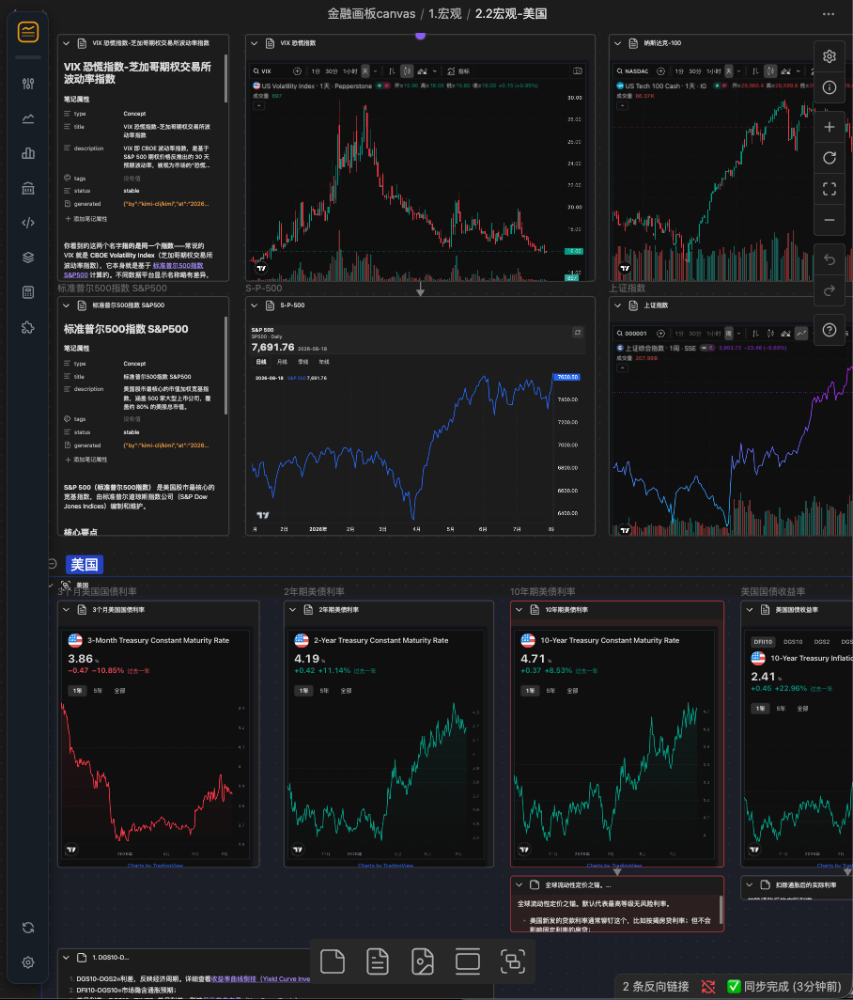

  <picture>
    <source media="(prefers-color-scheme: dark)" srcset="docs/LOGO/logo-text-dark.svg">
    
  </picture>

 在Obsidian里插入金融数据，数据源完全自定义。Agent-Native，内置 AI 助手与 MCP/CLI，建议搭配Agent使用。 
  

## 功能

**基本功能**
- **数据卡**：单一数据，由你配置的自定义数据源驱动。支持常见数据类型。支持日/周/月/季/年周期，**本插件不支持分钟/小时级别的高频数据**。
- **对比卡**：多数据序列同图对比；
- **计算卡**：对数据序列做简单的四则运算；

**高级功能**
- **TradingView 组件**：可以直接在obsidian内插入TradingView Widgets组件；建议搭配 [TradingView Widget 官方文档](https://www.tradingview.com/widget-docs/widgets/charts/)，了解各 Widget 支持的配置项；
- **日历与日记功能**：与obsidian基础功能联动，支持日历/日记功能。单击数据卡某一天的K线亦可建立当天日记。
- **导出图片**：把卡片渲染成 PNG，可手动导出，也可经 MCP/CLI 调用；
- **自定义技术指标**：不内置指标，支持用户自行提供的 .js 指标文件，可让 AI 辅助编写，或从 [lightweight-charts-indicators](https://github.com/deepentropy/lightweight-charts-indicators)（基于 lightweight-charts 的常用技术指标库）改写而来；插件不提供买卖信号，指标自行返回的标记仅作为展示结果。
- **自定义脚本计算**：对数据序列做更复杂的运算；支持csv数据表，通过脚本计算得出的csv数据表可直接注册为数据源；
- **Agent-Native**：内置 **AI 助手面板**（BYOK），可辅助配置数据源、创建卡片、编写指标与脚本，产出均为提案、需你确认后生效；内置 MCP/CLI，可搭配 [claudian](https://github.com/yishentu/claudian)、[hermes](https://github.com/NousResearch/hermes-agent)、[openclaw](https://github.com/openclaw/openclaw) 等 Agent 使用，也可使用自己的 AI Agent。

## 演示

详见 [演示](docs/演示.md)。

## 安装

本插件已上架obsidian**社区插件市场**。需要 Obsidian 桌面版 **1.11.4** 或更高版本（凭据存储依赖 SecretStorage API）。

### 方式一：从obsidian社区插件市场中下载（推荐）

1. 打开设置-第三方插件-关闭安全模式
2. 社区插件市场搜索 “StrataBoard”，安装并启用即可。
3. 如需 MCP/CLI，再打开与插件版本号完全一致的 [GitHub Release](../../releases)，手动下载 `cli.js`、`mcp-server.js`，放入 `.obsidian/plugins/strataboard/`。插件不会自行下载或更新这些文件。

### 方式二：下载 Release

1. 从 [Releases](../../releases) 选择所需版本，下载 `main.js`、`manifest.json`、`styles.css` 三个文件（需要 MCP/CLI 的话再下载 `cli.js`、`mcp-server.js`）。这些文件必须来自同一个版本的 Release。
2. 在你的库目录下新建文件夹 `.obsidian/plugins/strataboard/`，把文件放进去。
3. 重启 Obsidian，在 设置 → 第三方插件 中启用 **StrataBoard**。

## 使用
详见 [如何使用](docs/如何使用%20how%20to%20use.md)

## 免责声明

- 本插件代码依据 MIT 许可证发布，可在许可证范围内使用（包括商业使用）；本插件**不内置任何数据源**，也不授予任何第三方数据或内容的使用权。
- 第三方数据能否用于商业用途、缓存、展示、导出或再分发，以相应来源的许可证、服务条款及你取得的授权为准。
- 本插件展示的内容**不构成任何投资建议**。
- 除你自行配置的数据接口、AI 助手接口与 TradingView 组件外，插件不会向任何服务器发送数据。API Key 保存在 Obsidian 的 SecretStorage 中，插件 `data.json` 只保存凭据引用、不含密钥本身；CLI/MCP 通过你显式设置的环境变量获得密钥。密钥仅发送到你配置的对应接口。缓存数据保存在 vault 本地。
- TradingView 是独立的第三方服务，与本插件及 Obsidian 均无隶属或背书关系；TradingView 组件的内容由其官方提供并受其服务条款与隐私政策约束。

完整版见 [免责声明](docs/免责声明.md)。

## License
MIT（见 [LICENSE](LICENSE)）。第三方依赖的许可见 [THIRD-PARTY-LICENSES.md](docs/THIRD-PARTY-LICENSES.md)；两份文件也会作为 Release 附件发布，许可证文本同时嵌入各 JavaScript bundle。

## 支持这个项目

StrataBoard 以 MIT 许可证免费开放，无广告、无遥测，也不锁定任何功能。如果它帮你省下了时间，欢迎请我喝杯奶茶——打赏纯属自愿，不解锁额外功能，也不影响你使用完整插件。

| 微信赞赏 | 支付宝赞赏 |
| :---: | :---: |
|  |  |

- 也欢迎提交 Issue / PR、补充文档，或分享你的使用案例。
