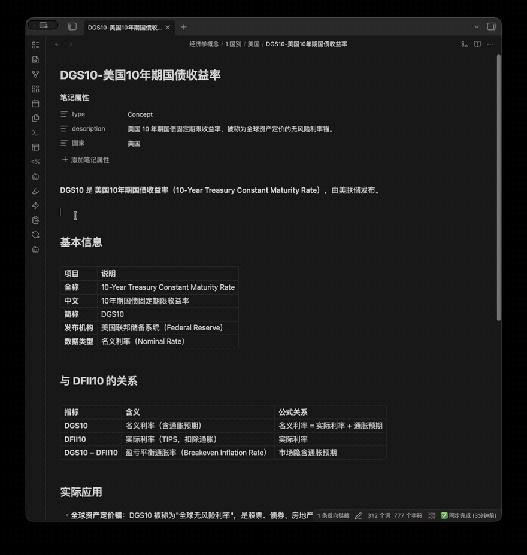
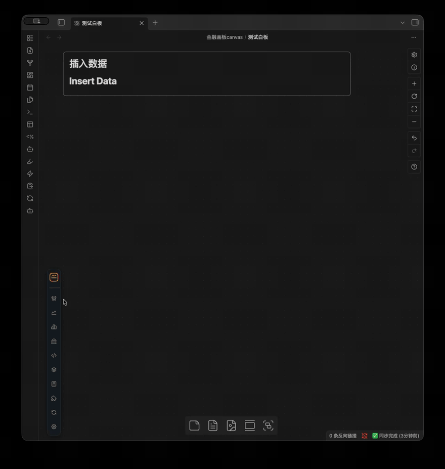
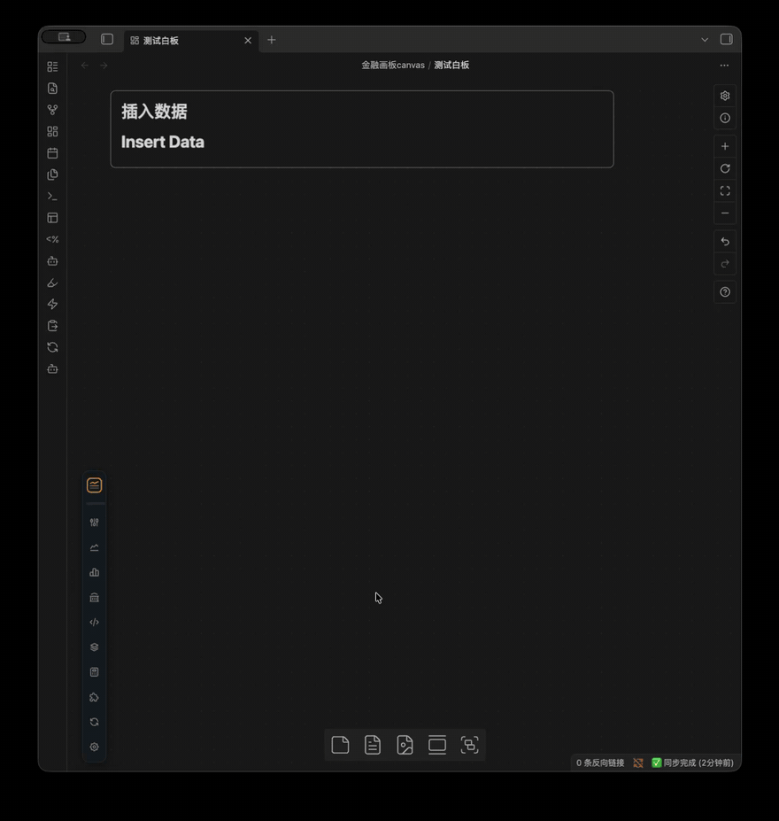
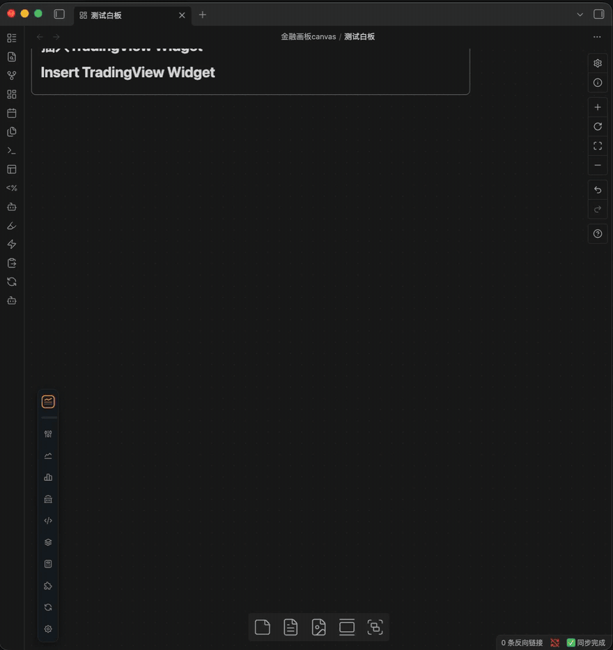

# 演示

> 持续补充中，更多 GIF 说明陆续添加。

## 在 Markdown 文档中插入数据

## 在 Canvas 中插入数据

组合多张卡片，搭建自己的数据白板：

## 宏观数据卡

## 插入 TradingView 小组件

从 TradingView Widgets 页面复制官方嵌入代码，粘贴即可；其他域名和任意 HTML 不会被接受：

## 利用本地 AI Agent 辅助

（待补充）

## 技术指标

（待补充）

## 脚本计算

（待补充）
